<p align="center">
  <a href="https://recollecthub.com">
    <picture>
      <source media="(prefers-color-scheme: dark)" srcset="docs/assets/readme/hero-ink.svg" />
      
    </picture>
  </a>
</p>

<p align="center">
  <a href="https://recollecthub.com"><b>Website</b></a> ·
  <a href="https://recollecthub.com/docs/">Documentation</a> ·
  <a href="#quickstart">Quickstart</a> ·
  <a href="#how-it-works">How it works</a> ·
  <a href="#dynamic-skills">Dynamic skills</a> ·
  <a href="#governed-mcp-tools">MCP tools</a> ·
  <a href="https://github.com/MikeK184/Recollect/issues">Issues</a>
</p>

<p align="center">
  <a href="LICENSE"></a>
  <a href="docs/foundation/techstack.md"></a>
  <a href="docs/runbooks/agent-memory-tools.md"></a>
  <a href="docs/runbooks/installation.md"></a>
</p>

**Recollect is a self-hosted Brain for your coding agents.** When a Codex, Claude
Code or OpenCode session ends, what it learned usually goes with it. Recollect
keeps it: it captures each session, learns the decisions and fixes the evidence
supports, and hands the next session that context, with citations, before its
first prompt. It also keeps your team's skills in sync across every host and
decides which MCP tools an agent may run, and where.

| | |
| --- | --- |
| **Memory that carries over** | Decisions, investigations, fixes and handovers are learned from sessions and repositories, checked against their sources and recalled with citations. |
| **Dynamic skills** | Publish a skill or shared instructions once in the Brain. Every connected host installs it as a native skill and loads the body only when it applies. |
| **Governed MCP tools** | Tool groups grant separate Use, Manage and Share rights. Reading a Brain never grants permission to run its tools. |
| **Private execution** | A paired runner connects outbound and runs approved calls inside your network, so an agent anywhere can reach an internal filesystem or service. |
| **Agents that coordinate** | Sessions on different machines announce their scope and planned files and exchange advisory notes before their work collides. |
| **Yours to run** | One Docker Compose stack on your laptop or a private server. You choose capture, retention and model policies, and inspect everything in the desktop app. |

## Quickstart

You need Docker with Compose and Python 3.11 or newer.

**1. Run Recollect.**

```sh
git clone https://github.com/MikeK184/Recollect.git
cd Recollect
./scripts/stack.sh up --build
```

Open **http://127.0.0.1:8787** and sign in with `RECOLLECT_OWNER_USERNAME` and
`RECOLLECT_OWNER_PASSWORD` from the `.env` file the first run generated. The
stack runs PostgreSQL with pgvector, Neo4j, the API and the worker.

**2. Connect your agent.** Open **Agents → Connect agent** in the app, build the
plugin package and install it in your coding host. For Claude Code:

```sh
python3 scripts/package-plugin.py     # prints the package directory
claude plugin marketplace add <package-directory>
claude plugin install recollect-memory@recollect
```

Run the bundled `recollect-connect` skill, choose your Brain and approve the
device code in your browser. The credential stays in your OS keychain. Codex and
OpenCode use the same package; see [plugin installation](plugins/recollect/README.md).

**3. Work as usual.** Start your coding host normally. Before each prompt the
plugin adds the memories that apply, with citations, and captures what the
session produces.

To let Recollect learn and search by meaning, add an `OPENAI_API_KEY` to `.env`
and turn on a model policy for the Brain ([provider and learning policies](docs/runbooks/provider-learning.md)).
Model requests are billed by the provider.

<details>
<summary><b>Everyday stack commands</b></summary>

```sh
./scripts/stack.sh status       # Show service state
./scripts/stack.sh logs         # Follow API and worker logs
./scripts/stack.sh stop         # Stop everything and keep all data
./scripts/stack.sh up           # Start again
./scripts/stack.sh up --build   # Rebuild after code or UI changes
```

`stop` keeps containers and data; `down` removes containers and keeps data. Never
add `--volumes` when you want to keep data. For native development, stop the
stack and run `./scripts/dev.sh`, which keeps only the databases in Docker. Shared
HTTPS access is covered in the [installation guide](docs/runbooks/installation.md).

</details>

## How it works

<picture>
  <source media="(prefers-color-scheme: dark)" srcset="docs/assets/readme/system-ink.svg" />
  
</picture>

A **Brain** holds the knowledge, skills, tool connections and access rules for a
person, team or project. Your agents connect to it through the plugin or direct
MCP, and the same loop runs on every prompt:

<picture>
  <source media="(prefers-color-scheme: dark)" srcset="docs/assets/readme/loop-ink.svg" />
  
</picture>

1. **Capture.** The plugin records the session events your capture policy permits
   through a durable queue, along with imported documents and repository snapshots.
2. **Learn.** Recollect extracts claims, decisions, procedures and handovers, and
   checks each one against its source before it counts. You can review, correct,
   withdraw or erase anything.
3. **Recall.** Before each prompt, exact, keyword, semantic and graph recall pick
   what applies to the task's repositories and environment, within an 8 KiB budget.
4. **Act.** The agent works with that context. Skills load when needed, approved
   MCP calls run where you placed them, and their outcomes become new evidence.

## Dynamic skills

<picture>
  <source media="(prefers-color-scheme: dark)" srcset="docs/assets/readme/skills-ink.svg" />
  
</picture>

Brain managers publish skills (`SKILL.md`) and shared instructions (`AGENTS.md`)
under **Agents → Skills**. At the next task boundary the plugin installs the
current revision into each host's own skills folder and asks the host to reload:

| Host | Native folder | Reload |
| --- | --- | --- |
| Claude Code | `.claude/skills/` | Startup hook and `reload_skills` |
| Codex | `.agents/skills/` | Native file watching |
| OpenCode | `.opencode/skills/` | `ctx.skill.reload()` at the next context boundary |

Agents see compact metadata first; `skills.fetch` loads a body or referenced file
only when a skill applies. Copies are temporary per task unless you pin them with
`--persist`. Bundles hold Markdown and text only, with no scripts or permission
overrides, and guidance never ranks above your local repository instructions.
See [shared skills and instructions](docs/runbooks/managed-skills.md).

## Governed MCP tools

<picture>
  <source media="(prefers-color-scheme: dark)" srcset="docs/assets/readme/tools-ink.svg" />
  
</picture>

Connect an MCP server once, add it to a **tool group** and grant people **Use**.
Every call is checked before it runs, then dispatched to the executor you chose.

| Setting | What it decides |
| --- | --- |
| **Tool group** | Which connections a caller can use, optionally limited to one environment |
| **Use / Manage / Share** | Separate rights to run tools, edit the group and grant access. Administrators do not inherit Use |
| **Runs on** | The Recollect service (central HTTP servers such as Context7 or Exa), the caller's device, or a named private runner |

A **private runner** is a paired device inside your network. It connects outbound,
claims calls addressed to it and returns results, so it needs no inbound port. It
runs only approved definitions: an agent cannot turn it into a shell. Credentials
can come from Vault. See [connections and tool groups](docs/runbooks/mcp-catalogue.md)
and [private runners](docs/runbooks/mcp-vault-and-private-runners.md).

## The MCP tools your agent sees

The plugin and direct MCP clients reach the same scoped tools at
`/api/brains/<brain>/mcp/agent`. Every call is bound to an immutable task scope,
so a model cannot switch Brains or widen its own access.

| Family | For | Tools |
| --- | --- | --- |
| `workspace.*` | Scoping each task | `list` `start_task` `set_scope` `begin` `inspect_task` `close` |
| `memory.*` | Recall and contributions | `recall` `inspect` `contribute` `handover` `graph_explore` `graph_path` |
| `skills.*` | Shared guidance | `list` `fetch` |
| `source.*` | Retained documents | `list` `import` `inspect` |
| `coordination.*` | Working alongside peers | `announce` `peers` `inbox` `send` `ack` `close` |
| `mcp.*` | Governed tool calls | `profiles` `discover` `call` `status` `cancel` `reconcile` |

Direct MCP uses a revocable token and does not install the plugin's automatic
capture hooks; see [agent memory and MCP setup](docs/runbooks/agent-memory-tools.md).

## What's inside

Rust powers the API, the worker and the plugin runtime bundled into each host
package. PostgreSQL holds canonical records and policy, pgvector serves semantic
recall, and Neo4j with GDS serves graph traversal and analytics. The desktop app
is React with Tailwind CSS and shadcn/ui, in Light and Ink themes. The same stack
runs locally or on a private server. [Cognee](https://github.com/topoteretes/cognee)
and other memory systems informed the design; none is a required runtime.

## Documentation

The full guides are at **[recollecthub.com/docs](https://recollecthub.com/docs/)**,
built from the Markdown in this repository.

| I want to… | Start here |
| --- | --- |
| Install Recollect or set up shared HTTPS access | [Installation](docs/runbooks/installation.md) |
| Connect Codex, Claude Code or OpenCode | [Agent memory and MCP setup](docs/runbooks/agent-memory-tools.md) |
| Control what is captured and sent to a model | [Session capture](docs/runbooks/session-capture.md) and [provider policies](docs/runbooks/provider-learning.md) |
| Work across repositories and environments | [Workspace scope](docs/runbooks/workspace-scope.md) |
| Publish skills and shared instructions | [Shared skills](docs/runbooks/managed-skills.md) |
| Govern MCP tools and private runners | [Tool groups](docs/runbooks/mcp-catalogue.md) and [private runners](docs/runbooks/mcp-vault-and-private-runners.md) |
| Find my way around the desktop app | [Desktop guide](docs/runbooks/desktop-experience.md) |
| Develop the backend or UI | [Local development](docs/runbooks/local-development.md) |
| Understand the architecture | [Vision and technology stack](docs/foundation/README.md) |

## Project status

Recollect is an early project for individuals and trusted internal teams. The
first planned product scope is implemented and locally tested, including dynamic
skills, peer coordination, private runners and the Light and Ink desktop app.
The [roadmap](docs/roadmap/epics/index.md) tracks what remains, such as native-host
acceptance for direct MCP tokens and further memory evaluation. Measured results
and their limits are in the [public retrieval benchmark](docs/runbooks/public-memory-benchmark.md).
Local validation is not a production capacity or deployment guarantee, and the
illustrations above use example data.

## Contributing

Issues and focused pull requests are welcome. Include tests for behavior changes
and run `./scripts/validate.sh` for the documentation checks. [AGENTS.md](AGENTS.md)
describes the repository conventions.

## License

Licensed under [Apache-2.0](LICENSE).
